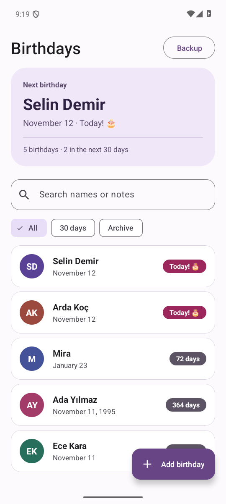
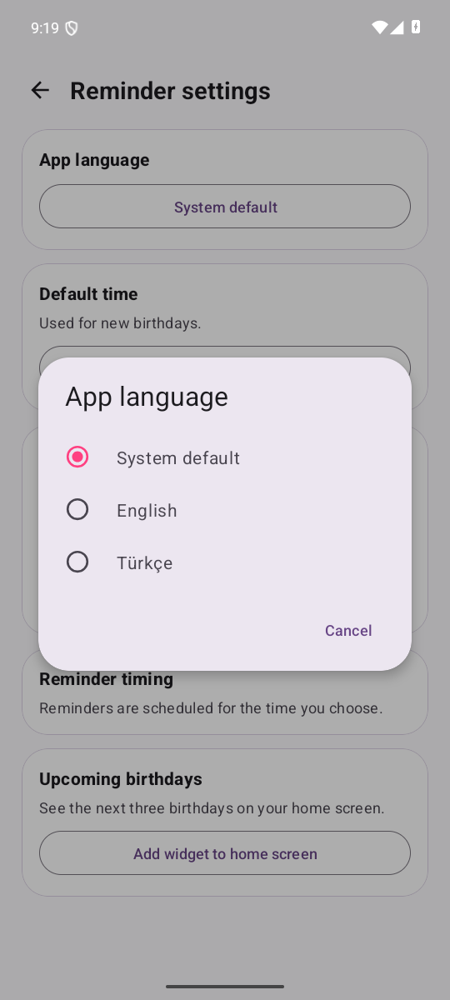

# Birthday Reminder

[🇹🇷 Türkçe](README.md) · **🇬🇧 English**

Birthday Reminder is an offline Android app for keeping track of upcoming birthdays. Set a separate reminder schedule for each person, keep gift notes, and move your records between devices with a JSON backup.

[Latest release and APK](https://github.com/KaanKaya17/BirthdayReminder/releases/latest)

 

## Features

- **Quick entry.** Add a name, day, and month. The birth year is optional. Save gift ideas and message drafts in the notes.
- **Multiple reminders per person.** Choose a day and time for each reminder. You can schedule several reminders on the same day. The app shows a separate notification for each person, even when birthdays coincide.
- **Notification actions.** Snooze a reminder for **1 hour**, mark the birthday as **Celebrated**, or open an editable greeting with **Write message**.
- **Upcoming birthdays.** See the next birthday and filter the list to the next 30 days. Search by name or note. The home-screen widget shows the next three birthdays.
- **Archive and backup.** Archive records you want to keep for later. Export a JSON backup, see when it was created, and preview how many new birthdays will be added before restoring. Earlier JSON backup formats are supported.
- **English and Turkish.** Choose **System default**, **English**, or **Türkçe** under **Backup → Reminder settings → App language**. The screens, dates, new notifications, greeting text, and widget follow the selected language.
- **Light and dark themes.** The app follows the system theme. The date fields stack vertically at larger text sizes.

## Install or update

1. Download the signed `BirthdayReminder-<version>.apk` from the [latest release](https://github.com/KaanKaya17/BirthdayReminder/releases/latest). The app requires **Android 13 or later**.
2. Open the APK. If Android asks, allow the browser or file manager that opened it to install apps from that source.
3. Open **Reminder settings** to allow notifications. Use **Send test notification** to check your settings.
4. Use **Open exact alarm settings** if you want reminders closer to the chosen time. Android may deliver them later when exact alarms are off.

**Updating.** Version 1.5 supports in-place upgrades from earlier official GitHub APKs. Install it over your current version to keep your birthdays. If you built an APK with a different signing key, export and verify a JSON backup before switching installations. Use **Restore from backup** in the signed release to bring your birthdays back.

## Reminders, widget, and backups

- Open a birthday and choose **Edit → Add reminder**. Pick a day and time and repeat to add more reminders.
- Open **Backup → Reminder settings → Add widget to home screen**. Supported Android launchers will offer to pin the widget.
- Open **Backup → Create backup file** to export active and archived birthdays, notes, reminder schedules, and celebration status.
- Open **Backup → Restore from backup** and select a JSON file. Review the preview and confirm. The app adds new birthdays and keeps existing records.

## Data and privacy

Birthdays are stored locally in a Room database. The app works offline and needs no account. Android may back up the database and preferences according to your system backup settings. Exported JSON files contain names, birthdays, and notes. You choose where to save them.

When reporting a problem, include your device model, Android version, app version, and steps to reproduce. Use fictional names in examples. [Report an issue](https://github.com/KaanKaya17/BirthdayReminder/issues)

## Development

The app uses Java, AndroidX View Binding, Material 3, Room, and Android AlarmManager. Open the project in Android Studio with Android SDK 36 installed. The bundled JDK can run Gradle.

```powershell
.\gradlew.bat :app:assembleDebug
.\gradlew.bat :app:testDebugUnitTest :app:lintDebug
.\gradlew.bat :app:connectedDebugAndroidTest
```

The last command requires an Android device or emulator. The debug APK is built at `app/build/outputs/apk/debug/app-debug.apk`.

On macOS and Linux, run the same Gradle tasks with `./gradlew`. [Build and sign a release](docs/releasing.md)

- **`data/`** Room schema, migrations, and JSON backups
- **`notification/`** annual reminder scheduling, simultaneous birthdays, and snoozing
- **`widget/`** upcoming birthdays on the Android home screen

[Release history](https://github.com/KaanKaya17/BirthdayReminder/releases)
