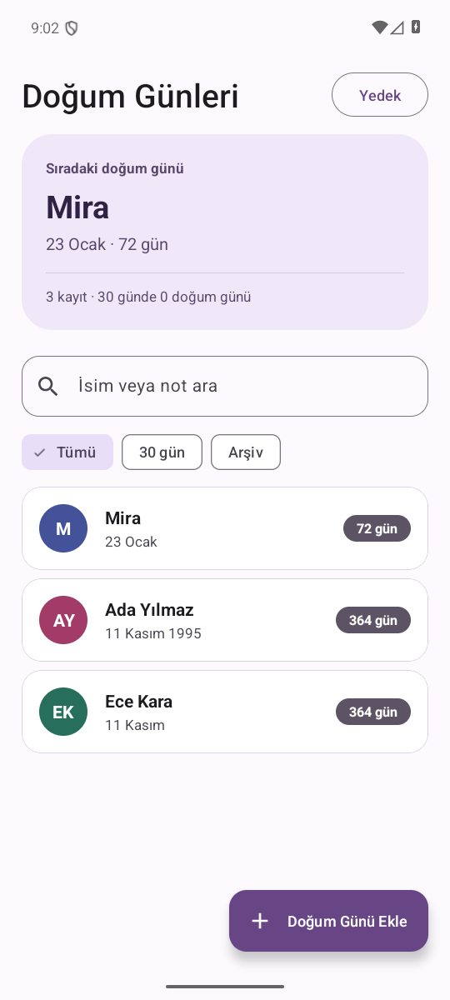
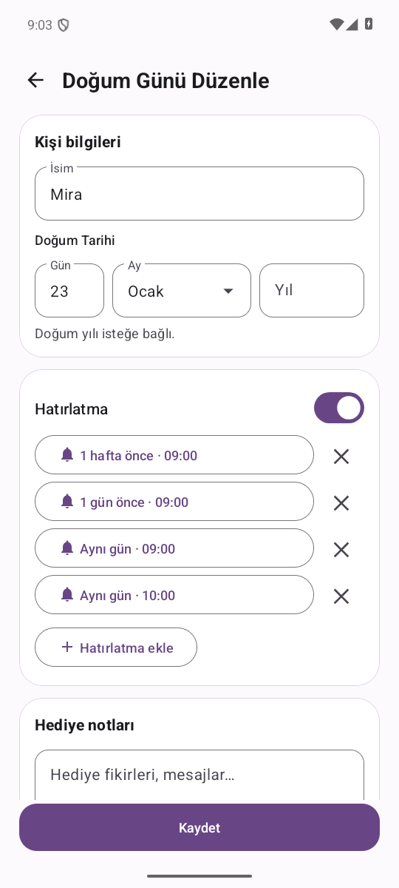

# Birthday Reminder

**🇹🇷 Türkçe** · [🇬🇧 English](README.en.md)

Android için Türkçe ve İngilizce kullanılabilen çevrimdışı doğum günü hatırlatıcısı. Yaklaşan tarihleri gör, her kişi için kendi bildirim planını oluştur ve kayıtlarını bir JSON dosyasıyla taşı.

[**Android için indir**](https://github.com/KaanKaya17/BirthdayReminder/releases/latest) · [Bildirim planı, widget ve yedekleme](#bildirim-planı-widget-ve-yedekleme)

 

## Neler yapabilirsin?

- **Hızlı kayıt.** İsim, gün ve ay ile kayıt oluştur. Yıl isteğe bağlı. Hediye ve kutlama fikirlerini kişinin notlarına ekle.
- **Kişiye özel bildirim planı.** Aynı gün 09.00 ve 19.00 gibi birden fazla saat seçebilir, bunlara bir hafta önce gibi ek hatırlatmalar ekleyebilirsin. Birden fazla kişinin doğum günü aynı tarihteyse her biri kendi bildirimiyle görünür.
- **Bildirimden işlem yapma.** Hatırlatmayı **1 saat sonra** tekrar göster, **Kutladım** ile o yılın kalan hatırlatmalarını kapat veya **Mesaj yaz** ile düzenlenebilir bir kutlama taslağı aç.
- **Yaklaşan doğum günleri.** Ana ekranda sıradaki doğum gününü ve önümüzdeki 30 günü gör. İsim veya notla ara. Widget, en yakın üç kayda doğrudan erişim sağlar.
- **Arşiv ve yedek.** Kullanmadığın kayıtları arşivle ve istediğinde geri getir. JSON yedeği oluştur, son yedek zamanını gör ve geri yüklemeden önce kaç yeni kaydın ekleneceğini kontrol et.
- **Türkçe ve İngilizce.** **Yedek → Hatırlatma ayarları → Uygulama dili** üzerinden **Sistem dili**, **English** veya **Türkçe** seç. Ekranlar, tarihler, yeni bildirimler, kutlama metni ve widget seçilen dile uyarlanır.
- **Açık ve koyu tema.** Uygulama sistem temasını izler. Büyük yazı boyutunda kayıt formundaki tarih alanları dikey olarak yerleşir.

## Kurulum ve güncelleme

1. **Android 13 veya üstü** bir cihazda [son sürümden](https://github.com/KaanKaya17/BirthdayReminder/releases/latest) imzalı `BirthdayReminder-<sürüm>.apk` dosyasını indir.
2. APK'yı aç. Android sorarsa dosyayı açan tarayıcıya veya dosya yöneticisine bu kaynaktan uygulama yükleme izni ver.
3. Kurulumdan sonra **Hatırlatma ayarları** üzerinden bildirim iznini ver. **Test bildirimi gönder** ile kontrol edebilirsin.
4. Seçtiğin saate daha yakın bildirim için **Kesin alarm ayarını aç** seçeneğini kullan. Android, kesin alarm izni kapalıyken bildirimi daha geç gösterebilir.

**Güncelleme.** Resmî GitHub APK’ları, 1.5 sürümüyle gelen imza geçişi desteği sayesinde mevcut kurulumun üzerine yüklenebilir. Mevcut sürümü kaldırmadan yeni APK'yı üzerine yükle. Kendi derlediğin bir APK farklı bir anahtarla imzalandıysa önce mevcut uygulamadan JSON yedeği al. Yedek dosyasını doğruladıktan sonra imzalı sürümü kurup **Yedekten geri yükle** seçeneğini kullan.

## Bildirim planı, widget ve yedekleme

- Bir kayıt açıp **Düzenle → Hatırlatma ekle** yolunu izle. Gün ve saat seç. Farklı saatler için işlemi tekrarla. Kayıt detayında planı ve sıradaki bildirimi görebilirsin.
- **Yedek → Hatırlatma ayarları → Ana ekrana widget ekle** yolunu izle. Desteklenen Android başlatıcılarında widget doğrudan ana ekrana eklenebilir.
- **Yedek → Yedek dosyası oluştur** ile etkin ve arşivlenmiş kayıtları, notları, bildirim planlarını ve kutlama durumunu dışa aktar.
- **Yedek → Yedekten geri yükle** ile bir JSON dosyası seç. Önizlemeyi onayladığında uygulama yeni kayıtları ekler ve mevcut kayıtları korur. Önceki JSON yedek biçimleri de okunur. Aynı kişinin notları veya bildirim planı yedektekinden farklıysa yedekteki kayıt ayrıca eklenebilir.

## Bildirim gelmiyorsa

**Yedek → Hatırlatma ayarları** bölümünden bildirim iznini kontrol et ve bir test bildirimi gönder. Test bildirimi geliyor ancak planlanan hatırlatma gecikiyorsa kesin alarm iznini kontrol et. Doğum günü kaydının etkin olduğunu ve detayında bir sonraki bildirimin göründüğünü doğrula.

## Veri ve gizlilik

Kayıtlar cihazda Room veritabanında tutulur. Uygulama çevrimdışı çalışır ve hesap gerektirmez. Android'in yedekleme ayarları açıksa sistem veritabanını ve uygulama tercihlerini yedekleyebilir. Dışa aktardığın JSON dosyası isimleri, doğum tarihlerini ve notları içerir. Saklanacağı konumu sen seçersin.

Bir sorun yaşarsan cihaz modelini, Android ve uygulama sürümünü, ardından sorunu tekrarlama adımlarını GitHub Issues'da paylaş. Örneklerde kişisel kayıtlar yerine kurgusal isimler kullan. [Sorun bildir](https://github.com/KaanKaya17/BirthdayReminder/issues)

## Geliştirme

Proje Java, AndroidX View Binding, Material 3, Room ve Android AlarmManager kullanır. Android Studio'da kök klasörü aç, Android SDK 36'nın kurulu olduğundan emin ol ve `app` yapılandırmasını çalıştır. Gradle için Android Studio'nun beraberinde gelen JDK kullanılabilir.

```powershell
.\gradlew.bat :app:assembleDebug
.\gradlew.bat :app:testDebugUnitTest :app:lintDebug
.\gradlew.bat :app:connectedDebugAndroidTest
```

Son komut için bağlı bir Android cihazı veya çalışan emülatör gerekir. Oluşan debug APK'sı `app/build/outputs/apk/debug/app-debug.apk` konumundadır.

macOS ve Linux'ta aynı Gradle görevlerini `./gradlew` ile çalıştırabilirsin. [Sürüm derleme ve imzalama](docs/releasing.md)

- **`data/`** Room şeması, sürüm geçişleri ve JSON yedekleme
- **`notification/`** yıllık planlama, eş zamanlı doğum günleri ve erteleme
- **`widget/`** yaklaşan doğum günleri için Android ana ekran widget'ı

[Sürüm geçmişi](https://github.com/KaanKaya17/BirthdayReminder/releases)
